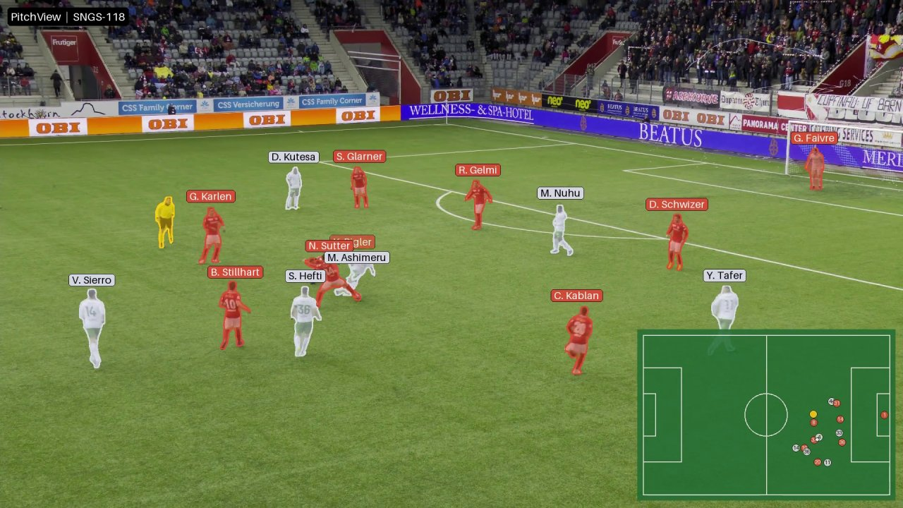
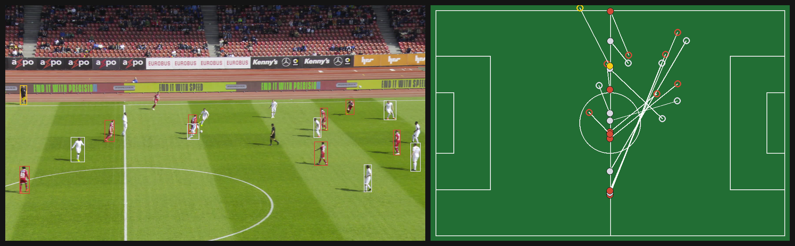
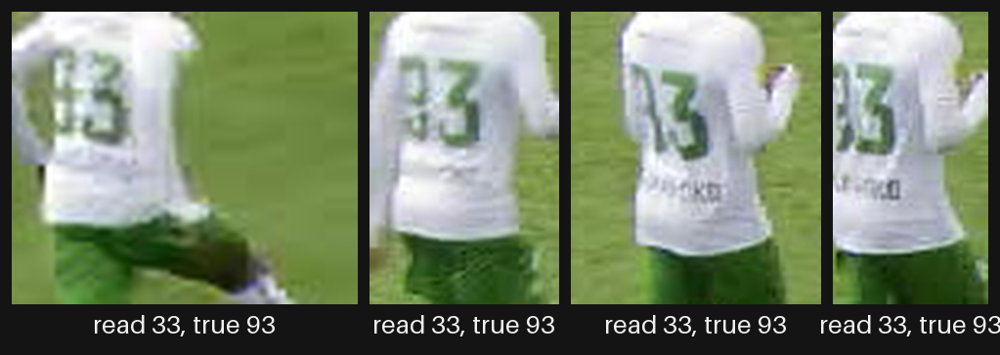
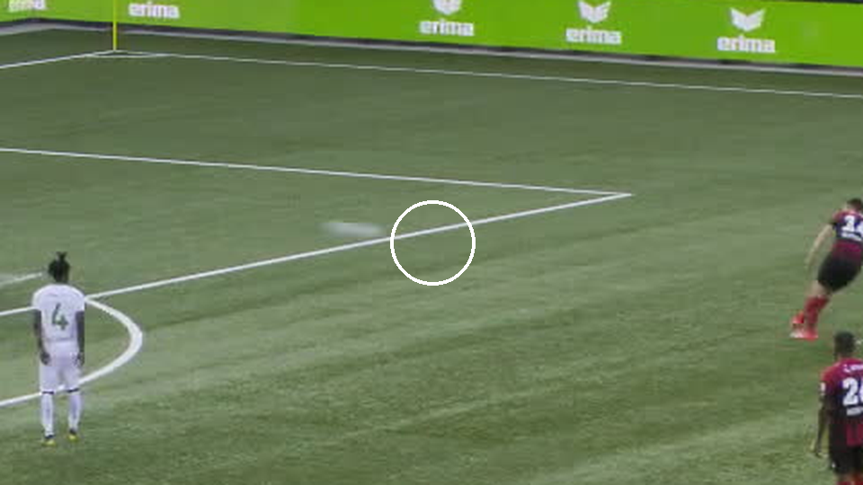
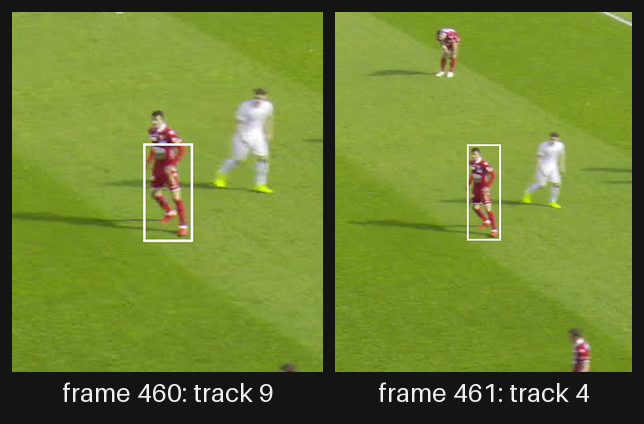

# PitchView

PitchView turns broadcast soccer video into the game state: every player's team, role, jersey number and position on the pitch in metres, frame by frame.



*Test clip SNGS-118: each player's SAM 3.1 mask in their team's colour, a name from their read jersey number and the match sheet, and every position on the pitch (inset).*

- **39.7 GS-HOTA** on the SoccerNet Game State Reconstruction (GSR) test set, vs 23.1 for the official baseline scored the same way.
- **1.5 m** median error in pitch position.
- **About $40** of rented GPU time in total. Everything after the GPU stages runs on a laptop CPU.

## How it works

1. **Detect.** RF-DETR, fine-tuned on GSR, finds players, goalkeepers, referees and the ball.
2. **Mask and track.** SAM 3.1, used as published, gets one text prompt per clip ("person") and masks and tracks everyone. Each mask takes its role from the detector box it overlaps.
3. **Teams.** SigLIP embeddings of each mask's shirt pixels are clustered into the two kits. Goalkeepers the detector calls players are found by their kit, using the match's other clips.
4. **Jersey numbers.** PARSeq, fine-tuned on GSR's train split, reads the shirts; each track's number is the vote of its confident reads. In the demo, names come from the two matches' official line-ups.
5. **Position on the pitch.** A keypoint model, fine-tuned on auto-labelled GSR frames, gives each frame's mapping from image to pitch; each player's foot point becomes metres.
6. **Game state.** Rules catch SAM 3.1's slips (a mask that jumps to another player, one player held as two masks, people off the pitch). The result is scored with SoccerNet's official evaluator, summed up as match stats, and drawn on the video and in a viewer.

<details>
<summary>What it took to make SAM 3.1's tracks usable: each fix and what it was worth</summary>

Scores are GS-HOTA. Each fix was chosen on the 5 valid clips, then test was scored once; the numbers chain because the fixes landed one after another. "PARSeq as published" marks scores from before the jersey reader was fine-tuned.

**Keeping SAM 3.1 on the players**
- *Stay near the detector's boxes.* The "person" prompt also follows spectators and staff, and a track that drifts onto one keeps going. Keeping a SAM person only within 3 frames of a detector box: 37.2 → 39.7 on test.
- *Team colours from in-box crops only.* Crops of whatever a track had drifted onto formed their own cluster and put nearly every player on one team.
- *Clean masks.* About 30% of SAM 3.1's masks carried a stray piece elsewhere in the frame, which stretched the box, moved the foot point and spoiled the crops. Keeping the largest piece (plus sizeable pieces touching it): 27.0 → 29.4 on test, 27.7 → 36.3 on valid (PARSeq as published).
- *Hold more people.* SAM 3.1 keeps every person it has seen, including players who left the picture, and once it holds its limit it ignores newcomers. At the first limit (48), 38 of 49 test clips filled up; in demo clip SNGS-145 the camera pans to the goalkeeper and back, and every player after the pan went unmasked. Raised to 128, sam3's own default: unmasked detector people after that pan fell from 91% to 8%, valid 44.3 → 45.7, test 35.4 → 37.9 (the 40 test clips that had made 40+ tracks were run again). At 128, SAM 3.1 crashed part-way through 2 test clips (an internal bookkeeping error); PitchView then starts a new session on that frame, and each person found again keeps their id by mask overlap with the frame before.

**The right label on the right person.** Watching the demo clips turned up 11 wrong colours, names or missing masks, from four causes. The first four fixes below took valid from 45.7 to 47.1 and test from 37.9 to 39.4.
- *Cut a track where its mask jumps to another person.* In a tackle SAM 3.1 can move a mask from one player to another, or from the referee to a player. Team and role used to be voted once per track, so in SNGS-121 two masks that swap a red and a white player each kept the other's colour. Each mask crop now gets its own team, and a track is cut where its team changes for 4 crops in a row (about 20 frames), or its detector box changes between referee and player for 10 frames. A track is also cut where its jersey reads switch number (below). Each piece gets its own team, role and number, and linking by jersey rejoins the pieces of one player. Valid 45.7 → 46.0 on its own.
- *Join a person held as two masks.* SAM 3.1 sometimes holds one player as a torso mask and a legs mask. Neither matches the detector's box, so the player had no role and wasn't drawn (0.6% of the detector's people on test, 347 of them in SNGS-123). Masks inside one unmatched detector box are now one person when together they match it. Even on valid (45.7).
- *Drop people off the pitch.* Staff and firefighters behind the goal were boxed as goalkeepers and took the keeper's name. People more than 5 m outside the lines are dropped; in GSR's train labels, 99.9% of people stand within 3.6 m of the lines. Valid 45.7 → 46.0 on its own.
- *Find keepers by kit.* The detector called St. Gallen's keeper in SNGS-145 a player in 111 of 113 frames, so his tag showed "#?". Kits don't change within a match, so `keeper-kits` clusters the shirts inside goalkeeper boxes, over all of a match's clips, into its two keeper kits. A player track with 20+ crops, 80% of them nearer a keeper kit than either team or the referee, standing on the pitch, with no detected keeper of that side at the same time, becomes that side's keeper. Every valid keeper is boxed as one, so the rule changed nothing there; on test, 91% of the frames it relabels are keepers by the labels (1,888 of 2,073).
- *Team sides named per match half.* GSR names the teams by the goal they defend ("left" or "right"), which one clip can only guess from where each team stands. When play stays in one half the teams stand almost level (in SNGS-130 both average x = 30 m), and the guess is a coin flip. Teams change ends only at half-time, so PitchView names the sides once per match half, pooled over its clips (game id and half come from each clip's info): each clip's two kits are lined up by appearance, and the clips' summed positions name them. It has no setting, and the 5 valid clips all come from one half, so it was checked on test only: PitchView 39.4 → 39.5 (one clip, SNGS-148), the box-tracker system 36.2 → 37.1, perfect detection 38.4 → 39.9. Every test run is then left with the same 3 clips scored as swapped, which look like label slips: in game 7's second half, the team wearing #4, #44 and #50 is "right" in SNGS-124, 125, 127, 128, 129 and 130 but "left" in SNGS-126 and 131 (likewise SNGS-197 in game 11).

**The right number on the right player.** A number is voted per track, so when SAM 3.1 jumps from one player to another, the whole track used to take one player's number, and 4-12% of numbered player frames showed a number another player of the same team also had.
- *Split a track where its reads switch number for good.* A switch needs two confident reads of each number: when unsure reads counted too, one confident misread of SNGS-145's #16 as "10" cut his track in two and the second piece showed "#?". Counting only confident reads: valid 47.1 → 48.0, test 39.5 → 39.7. The split is worth +0.4 on test (39.3 without it).
- *One player per team shows a number at a time.* A clash goes to the track that wins most of its frames (frame by frame, the one whose own reads saw the number nearest in time), and that track keeps it throughout, so a name doesn't jump to another player and back. Even on the score (39.7 without it); it fixes the demo.
- *Join hand-offs.* In a tackle SAM 3.1 can let go of a player and start a new track on them a moment later, so the number read on the new track never reached the old one. Tracks of one team that end and start within 10 frames on overlapping boxes are one player: on SNGS-118, K. Bigler (#25) is named from his first frame instead of frame 310. Measured before the people limit was raised: even on valid (44.3 either way); on test it joined 13 pairs, all one player by the labels.
- *Link pieces that share a team and number.* +1.0 for SAM 3.1's tracks (38.7 without it), +0.6 for ByteTrack's (PARSeq as published).

**Smaller effects.** Checks that drop implausible or jumpy pitch mappings, plus 25-frame position smoothing: +0.9 (box system). Reading jerseys every 3rd frame instead of every 10th helped the reader on all 58 valid clips (43.1% vs 41.4% of player frames read right) but made no difference on test (28.1 vs 28.3, box system, PARSeq as published), so PitchView keeps every 10th frame.

</details>

## Results

Scored on the 49 test clips (3 games) with SoccerNet's official evaluator (sn-trackeval). Settings were chosen on the valid split first (5 clips for the pipeline, all 58 for the jersey reader). Two rules had no case on valid and were checked on test only: keepers by kit, and team sides per match half.

| Run | GS-HOTA | GS-HOTA, jerseys not checked | IDF1 | ID switches |
|---|---|---|---|---|
| Official baseline (sn-gamestate: PRTReID + StrongSORT), rescored | 23.1 | 38.3 | 46.9 | 7,077 |
| **PitchView** (SAM 3.1 masks and tracks, RF-DETR for roles) | **39.7** | 44.5 | 52.4 | 2,528 |
| with RF-DETR + ByteTrack box tracks instead of SAM 3.1's | 37.3 | 42.7 | 50.9 | 3,015 |
| without jersey numbers | 19.9 | 43.5 | 50.7 | 2,564 |
| off-the-shelf pitch model | 11.9 | 14.7 | 17.2 | 3,007 |
| with perfect calibration | 63.9 | 74.8 | 79.7 | 1,332 |

<details>
<summary>All 14 runs, with every column (each ablation switches one design choice)</summary>

| Run | GS-HOTA | DetA | AssA | GS-HOTA, jerseys not checked | Tracking HOTA | IDF1 | ID switches |
| --- | --- | --- | --- | --- | --- | --- | --- |
| Official baseline (sn-gamestate: PRTReID + StrongSORT), rescored | 23.1 | 11.1 | 48.0 | 38.3 | 43.6 | 46.9 | 7,077 |
| **PitchView** (SAM 3.1 masks and tracks, RF-DETR for roles) | **39.7** | 28.0 | 56.5 | 44.5 | 46.7 | 52.4 | 2,528 |
| with RF-DETR + ByteTrack box tracks instead of SAM 3.1's | 37.3 | 26.0 | 53.8 | 42.7 | 45.9 | 50.9 | 3,015 |
| with SAM 3.1's people in every frame, not only near the detector's boxes | 37.2 | 25.8 | 54.0 | 41.7 | 43.8 | 49.1 | 3,324 |
| without splitting a track where its jersey number changes | 39.3 | 27.7 | 56.0 | 44.3 | 46.5 | 52.1 | 2,515 |
| without the one-player-per-number rule | 39.7 | 27.9 | 56.7 | 44.5 | 46.7 | 52.4 | 2,528 |
| without track linking by jersey | 38.7 | 28.0 | 53.9 | 43.6 | 45.8 | 50.8 | 2,579 |
| without jersey numbers | 19.9 | 7.4 | 53.5 | 43.5 | 45.7 | 50.7 | 2,564 |
| foot point from the box, not the mask | 39.8 | 28.1 | 56.7 | 44.6 | 46.9 | 52.5 | 2,511 |
| teams from box crops, not mask crops | 39.4 | 27.7 | 56.3 | 44.3 | 46.6 | 52.2 | 2,550 |
| off-the-shelf pitch model | 11.9 | 5.9 | 24.4 | 14.7 | 16.5 | 17.2 | 3,007 |
| with perfect calibration | 63.9 | 52.0 | 78.5 | 74.8 | 80.1 | 79.7 | 1,332 |
| with perfect detection | 40.0 | 28.5 | 56.7 | 44.9 | 47.0 | 52.9 | 2,439 |
| with perfect detection and calibration | 65.7 | 54.1 | 79.8 | 76.8 | 81.3 | 81.3 | 1,215 |

</details>

How to read it:
- **GS-HOTA** (the benchmark's score, 0-100) counts a prediction only when it is within about 5 m of the true position and its role, team and jersey number all match. "Jerseys not checked" switches the number check off. **IDF1** and **ID switches** measure how well each person keeps one id over the clip.
- **The baseline** is the official one's own test predictions ([Zenodo 11065177](https://zenodo.org/records/11065177)), rescored with the same evaluator and the current labels: 23.1, vs 22.26 in the paper.
- **"Perfect" rows** swap in ground truth for one stage, to show where the remaining points are lost.
- **For scale:** the 2024 and 2025 challenge winners scored about 64 on the challenge set, with fine-tuned detectors, re-identification trackers, stronger calibration and stronger jersey readers (a vision-language model, a fine-tuned CLIP). PitchView is not in that league; the comparison here is with the official baseline, on the same split and evaluator.

What it shows:
- **+16.6 GS-HOTA over the baseline, mostly from jersey numbers.** With the number check off, the two are 6.2 apart (44.5 vs 38.3). Without jersey numbers PitchView scores 19.9.
- **Fine-tuning the jersey reader was the largest single gain: 29.5 → 35.4 GS-HOTA.** It reads the right number (or rightly no number) on 77.5% of player frames, up from 41.4% for PARSeq as published (all 58 valid clips), after 4 minutes of training on an RTX 4090.
- **Untrained SAM 3.1 tracks people better than ByteTrack on the fine-tuned detector's boxes:** 39.7 vs 37.3 GS-HOTA, 16% fewer ID switches (2,528 vs 3,015) and a higher IDF1 (52.4 vs 50.9). The detector only says who is a player, goalkeeper or referee, and finds the ball; that is why perfect detection adds little (40.0).
- **Fine-tuning the pitch model** on auto-labelled GSR frames cut the median position error from 7.8 m to 1.5 m (GS-HOTA 11.9 → 39.7).
- **Calibration is the largest remaining gap:** perfect calibration lifts GS-HOTA to 63.9. One unseen stadium drives it: games 7 and 8 were played at stadiums that also appear in the training split; game 11's (Letzigrund) does not.

  | GS-HOTA per test game | game 7 | game 8 | game 11 |
  |---|---|---|---|
  | Official baseline | 27.5 | 21.2 | 20.4 |
  | PitchView | 48.1 | 49.9 | 16.8 |
  | PitchView, perfect calibration | 63.3 | 66.4 | 62.2 |

- **Masks vs boxes are about even.** Team colours from mask crops score 39.7 vs 39.4 from box crops; the foot point from the mask scores 39.7 vs 39.8 from the box. The foot point can't do better: GSR defines each player's true position as the bottom-middle of their labelled box, so even with perfect calibration the median error is 0.18 m from the box vs 0.25 m from the mask.

<details>
<summary>How the jersey reader was fine-tuned</summary>

PARSeq as published read the right number (or rightly no number) on 41.4% of player frames across all 58 valid clips, with labelled boxes. After one epoch on GSR's train split (102,443 shirt crops from every 5th frame, each labelled with the player's number) it reads 77.5%, and the numbers it shows are right far more often (precision 85.5% vs 53.5%). Two training sets were tried, 4 epochs each: every crop, or only the crops where PARSeq already saw a digit of the number; the checkpoint was picked on valid. Later epochs read a number more often but get more of them wrong (precision 65% by epoch 4): the labels are weak, since a player keeps their number in frames where it can't be seen. Training took 4 minutes on an RTX 4090. On the valid clips, players whose number is visible somewhere showed "#?" in 15% of their frames, down from 25%. The +5.9 (29.5 → 35.4) was measured before SAM 3.1's people limit was raised.

</details>

<details>
<summary>Pitch-position error, in metres</summary>

For predictions matched to a true person, on test (`pitchview position-error`):

| Run | Median | 90th percentile | Within 1 m | Game 7 | Game 8 | Game 11 |
|---|---|---|---|---|---|---|
| PitchView (foot point from the mask) | 1.50 | 6.79 | 36% | 0.92 | 0.99 | 3.78 |
| foot point from the box | 1.49 | 6.80 | 37% | 0.90 | 0.97 | 3.79 |
| off-the-shelf pitch model | 7.81 | 23.53 | 4% | 7.54 | 9.74 | 5.68 |
| perfect calibration, mask | 0.25 | 0.60 | 96% | 0.26 | 0.24 | 0.23 |
| perfect calibration, box | 0.18 | 0.54 | 97% | 0.20 | 0.18 | 0.16 |

</details>

<details>
<summary>Detectors: accuracy and speed (RF-DETR vs YOLO26, and SAM 3.1's speed)</summary>

Both detectors were fine-tuned on the same frames (every 5th GSR train frame), from COCO-pretrained weights. Accuracy is box AP on test (every 5th labelled frame); speed is one frame at a time on an NVIDIA RTX PRO 4500 Blackwell, half precision, after a warm-up (`pitchview bench`).

| Detector | Input | mAP50-95 | AP50 | Player | Goalkeeper | Referee | Ball | FPS | Parameters |
|---|---|---|---|---|---|---|---|---|---|
| RF-DETR medium (used) | 1120 px | **0.460** | **0.775** | 0.621 | **0.548** | **0.495** | 0.177 | 57.5 | 34.8 M |
| RF-DETR medium, second run | 1280 px | 0.459 | 0.766 | 0.621 | 0.537 | 0.492 | **0.185** | | 34.8 M |
| YOLO26m | 1280 px | 0.423 | 0.696 | **0.626** | 0.446 | 0.460 | 0.159 | **70.5** | 21.8 M |

- RF-DETR is more accurate; YOLO26 is 23% faster with a third fewer parameters. They are level on players and differ on the rarer classes (goalkeepers, referees, the ball).
- Swapped into the box system (ByteTrack on the detector's boxes) on the valid clips, YOLO26 scores 35.4 GS-HOTA vs 36.7 with RF-DETR (PARSeq as published).
- The second RF-DETR run (1280 px, a gentler learning rate with a cosine decay, 12 epochs) ties the first on test and scores 36.2 vs 36.7 on the valid clips (PARSeq as published), so the first stays. The higher resolution helps only the ball, a little.
- The rest of the pipeline on the same card: pitch keypoints 79 fps, jersey reader 40 fps (every player in a frame).
- **SAM 3.1 is about 14x slower than RF-DETR.** It tracks people at about 4 frames a second on the same card (200 frames in 47 s, from its progress log: the benchmark itself crashed inside SAM 3.1's tracker). It keeps every past frame on the GPU, so a 30-second clip did not fit on a 24 GB card. The full pass on test (tracking, cleaning and saving masks, cropping shirts) ran at 2.6 frames a second on an RTX PRO 6000 Blackwell (96 GB) while SAM 3.1 held at most 48 people, and at about 1.5 with up to 128: the extra tracks cost CPU time, and the GPU sat mostly idle.

</details>

## Where it fails

Each example is picked by a stated rule (`pitchview failures`), not by hand.

- **Calibration at the unseen stadium** (the typical frame of the worst clip): on SNGS-191 the pitch model's mapping is 20.4 m off (median), so every player lands in the wrong place on the radar. Hollow: true positions; filled: predicted.
  
- **One misread decides a number** (the wrongly numbered track seen longest): on SNGS-118 a player wearing 93, with an arm across the 9, was read as 33. 6 of the track's 75 reads said 33 with enough confidence to vote, and 33 won, so all 732 frames carry the wrong number.
  
- **A fast ball** (the longest miss of a loose ball in play, on the pitch and away from every player): blurred into a 33 x 10 px streak, it goes undetected for 11 frames (0.4 s). Longer gaps happen only when the ball is held, at a player's feet or out of play.
  
- **An ID switch** (two long tracks that swap on one player): on SNGS-197 one player (boxed) is SAM 3.1's track 9 until frame 460, then track 4 from frame 461.
  

## Run it

```
uv sync                                   # Python 3.12 and every package
uv run python scripts/download_gsr.py     # SoccerNet GSR: train, valid and test, about 28 GB
uv run pitchview doctor                   # checks the data, the weights and the GPU
```

The GPU stages (detection, SAM 3.1, pitch keypoints, training) run on a rented Linux GPU with `scripts/run_gpu_jobs.sh`. Everything after them runs on any machine, from the saved outputs:

```
uv run pitchview keeper-kits                         # each match's two keeper kits
uv run pitchview assemble --name sam --tracker sam   # the game state: PitchView as scored above
uv run pitchview eval sam                            # GS-HOTA with the official evaluator
uv run pitchview render SNGS-118                     # the annotated video
uv run pitchview bundle SNGS-118 SNGS-121 SNGS-123 SNGS-137 SNGS-145
uv run pitchview viewer                              # the demo viewer, no model needed
```

Every stage also takes `--smoke` (2 clips, 10 frames, on the CPU). Details:

<details>
<summary>Install and weights</summary>

`uv sync` installs Python 3.12 and every package from `uv.lock`. The lock file serves both machines: CPU PyTorch on Windows, CUDA 12.8 PyTorch on Linux. SAM 3.1 is installed on Linux only. The data goes into `data/SoccerNetGS/gamestate-2024/`.

Model weights go in `weights/`, which git ignores:

| File | Where it comes from |
|---|---|
| `sam3.1_multiplex.pt` | [facebook/sam3.1](https://huggingface.co/facebook/sam3.1) on Hugging Face (gated: request access) |
| `football-pitch-detection.pt` | Roboflow's `sports` repo: `uvx gdown -O weights/football-pitch-detection.pt "https://drive.google.com/uc?id=1Ma5Kt86tgpdjCTKfum79YMgNnSjcoOyf"` |
| `parseq_gsr_all_e1.pt` | Train it on a GPU: `uv run pitchview train-jersey --name gsr_all --keep all --epochs 4` (about 4 minutes on an RTX 4090; the default jersey reader is epoch 1). Without it, read with PARSeq as published: `--reader zeroshot` |

Optional: to see the labels the detector trains on, convert them and draw boxes on a few frames.

```
uv run python scripts/convert_gsr.py
uv run python scripts/show_labels.py --split valid
```

</details>

<details>
<summary>Try every stage on a laptop (<code>--smoke</code>)</summary>

Each stage takes `--smoke`: 2 clips, 10 frames, on the CPU. SAM 3.1 needs CUDA, so in smoke mode it is replaced by the labelled boxes. Outputs go to `outputs/smoke/`.

```
uv run pitchview train-detector --smoke
uv run pitchview detect --split valid --smoke
uv run pitchview train-pitch --smoke
uv run pitchview keypoints --split valid --smoke
uv run pitchview sam --split valid --smoke
uv run pitchview train-jersey --smoke
```

A 1-epoch detector finds too little to track, so the rest of the run uses the labelled boxes (`--oracle`) and the exact pitch mapping (`--pitch oracle`):

```
uv run pitchview detect --split valid --smoke --oracle
uv run pitchview jerseys --split valid --smoke --dets oracle --reader zeroshot
uv run pitchview assemble --split valid --smoke --dets oracle --pitch oracle --name smoke --jersey-reader zeroshot
uv run pitchview stats --split valid --smoke --name smoke
uv run pitchview eval smoke --split valid --smoke
```

The scores come out tiny, because only 10 of each clip's 750 frames are processed. Jerseys are read with PARSeq as published (`zeroshot`): the fine-tuned reader comes from a GPU run.

</details>

<details>
<summary>Run the GPU stages on Runpod</summary>

The GPU stages need a Linux pod with an NVIDIA GPU (driver for CUDA 12.8 or newer) and a network volume mounted at `/workspace`.

Set up the pod:

```
# First pod: the repo isn't on the volume yet
curl -fsSL https://raw.githubusercontent.com/nathankyryk/pitchview/master/scripts/setup_pod.sh | bash

# Any later pod
bash /workspace/pitchview/scripts/setup_pod.sh
```

Setup ends with `pitchview doctor`. If the SAM 3.1 weights are missing, it prints the `scp` command to copy them from your machine.

Then run the stages:

```
bash scripts/run_gpu_jobs.sh check                      # ~30 min, attended
DETECTOR_EPOCHS=<n> bash scripts/run_gpu_jobs.sh train  # ~4.75 h
bash scripts/run_gpu_jobs.sh infer                      # ~3.25 h
bash scripts/run_gpu_jobs.sh sam                        # on a 48 GB+ card: SAM 3.1 masks and tracks
bash scripts/run_gpu_jobs.sh retrain                    # ~3 h: detector v2, its detections, speed table
bash scripts/run_gpu_jobs.sh yolo                       # ~1.5 h: YOLO26 on the same frames, its detections, speed
bash scripts/run_gpu_jobs.sh jersey                     # ~1.5 h: fine-tune the jersey reader, read valid and test
```

- **check** runs every job on 1 clip, times 1 epoch of each training job, and suggests a value for `DETECTOR_EPOCHS`. Its outputs go to `outputs/check/`.
- **train** fine-tunes the detector and the pitch-keypoint model.
- **infer** runs detection, pitch keypoints (fine-tuned and off-the-shelf) and jersey reading.
- **sam** runs SAM 3.1 on every test clip and keeps every mask. Its tracker holds every past frame on the GPU (~27 MB a frame), so a 750-frame clip needs ~40 GB. It holds up to 128 people at once (`pitchview sam --max-objects`); `SAM_CLIPS=SNGS-145,SNGS-116` runs only those test clips (clips already done are skipped).
- **retrain** trains a second detector into its own folder (lower learning rate with a cosine decay, 1280 px input), detects with it, then runs `pitchview bench`: every model one frame at a time on that GPU.
- **yolo** fine-tunes YOLO26m (`pitchview train-yolo`) on the detector's training frames, detects with it (`detect --dets yolo26`), and adds it to the speed table.
- **jersey** fine-tunes PARSeq (`pitchview train-jersey`) on the train split's shirt crops two ways, every crop and only the crops where PARSeq as published already reads a digit of the number, then reads all 58 valid clips (labelled boxes, for `jersey-score`) and the test clips with every checkpoint. `infer` and `sam` train the default reader first if its weights are missing.

Every stage but `check` runs inside tmux (`tmux attach -t train` to watch) and stops the pod when it ends, whether it succeeds or fails. Set `NO_STOP=1` to keep it running. Other settings: `DETECTOR_SIZE`, `DETECTOR_RES`, `DETECTOR_BATCH`, `DETECTOR_ACCUM`, `PITCH_EPOCHS`, `JERSEY_EPOCHS`. On a pod that only runs inference, `GSR_SPLITS="valid test" bash scripts/setup_pod.sh` skips the train split (~20 GB). With `HOLD_MINUTES=60` a stage waits up to an hour for `/workspace/logs/<stage>_copied` before stopping the pod, so its outputs can be copied home first.

Logs stay on the volume in `/workspace/logs/`. `<stage>_status.txt` has one line per step: ok or FAILED, and how long it took.

</details>

<details>
<summary>Build the game state and score it: every option</summary>

With the GPU outputs in `outputs/`, on any machine:

```
uv run pitchview keeper-kits
uv run pitchview assemble --name sam --tracker sam
uv run pitchview stats --name sam
uv run pitchview eval sam
```

`keeper-kits` saves each match's two keeper kits, for `--keeper-by-kit`; run it once per split and `--dets`. `--tracker sam` is PitchView as scored above. The default, `bytetrack`, is the comparison system: ByteTrack on the detector's boxes (run `main` in the table).

Commands default to the test split. `eval` prints GS-HOTA (SoccerNet's official metric) with its detection (DetA) and association (AssA) parts. It also prints a tracking-only HOTA, with the role, team and jersey checks switched off.

Each design choice is an `assemble` option, so a variant is one more run:

| Option | Values | Default |
|---|---|---|
| `--tracker` | `bytetrack`, `sam` | `bytetrack` |
| `--foot` | `mask`, `box` | `mask` |
| `--team-crops` | `mask`, `box` | `mask` |
| `--jersey` / `--no-jersey` | | on |
| `--smooth` | rolling-median window over positions, in frames (1 = off) | `25` |
| `--pitch` | `finetuned`, `offtheshelf`, `oracle` | `finetuned` |
| `--pitch-check` / `--no-pitch-check` | drop pitch mappings that put the camera on the far side or jump between frames | on |
| `--dets` | `model`, `oracle` (needs `detect --oracle` first), or a re-trained detector's name | `model` |
| `--merge-by-jersey` / `--no-merge-by-jersey` | one id for track pieces with the same team and number that never overlap | on |
| `--sam-box-gap` | with `--tracker sam`: keep a person only within this many frames of a detector box; `-1` keeps every frame | `3` |
| `--split-by-jersey` / `--no-split-by-jersey` | split a track where its jersey reads switch number for good (the tracker jumped to another player) | on |
| `--unique-numbers` / `--no-unique-numbers` | one player per team shows a number at a time: the one whose reads saw it nearest in time | on |
| `--episode-gap` | with `--unique-numbers`: clash frames up to this many frames apart form one clash, won throughout by the track that wins most of its frames; `-1` decides each frame on its own | `5` |
| `--split-jumps` / `--no-split-jumps` | with `--tracker sam`: cut a track where its mask jumps to another person (its team, or its role between referee and player, changes for good) | on |
| `--jump-team-run` | with `--split-jumps`: crops in a row (5 frames apart) that make a team change real | `4` |
| `--jump-role-run` | with `--split-jumps`: frames in a row that make a role change real | `10` |
| `--join-parts` / `--no-join-parts` | with `--tracker sam`: one person for masks that together fill a detector box no single mask matches | on |
| `--off-pitch` | drop people more than this many metres outside the lines; `-1` keeps everyone | `5` |
| `--keeper-by-kit` / `--no-keeper-by-kit` | with `--tracker sam`: a player track in a keeper's kit becomes a goalkeeper (needs `keeper-kits` first) | on |
| `--sides-by-half` / `--no-sides-by-half` | name the teams' sides once per match half, pooled over its clips (game id and half from the clips' info) | on |
| `--jersey-reader` | `zeroshot` (PARSeq as published) or a `train-jersey` checkpoint | `gsr_all_e1` |

For example, to compare foot points:

```
uv run pitchview assemble --name sam_boxfoot --tracker sam --foot box
uv run pitchview eval sam sam_boxfoot
```

`eval --detail` adds the error breakdown: GS-HOTA with each attribute check (jersey, team, role) switched off in turn, and the tracking errors behind the tracking-only score (missed and extra people, split and merged tracks, IDF1, ID switches). `--save results.json` keeps every score, per clip too.

Jersey numbers have their own scorer, which re-votes from the saved raw reads in seconds:

```
uv run pitchview jersey-score --split valid --limit 5 --grid
```

`jerseys` and `jersey-score` take `--reader` (`zeroshot` or a checkpoint such as `gsr_all_e3`), so readers compare on the same tracks.

More reports, all from saved outputs:

| Command | What it prints |
|---|---|
| `table eval1.json eval2.json` | The README's results table, from `eval --detail --save` files |
| `games sam main baseline` | GS-HOTA per test game (each game is one stadium) |
| `position-error sam sam_boxfoot` | Pitch-position error in metres: median, 90th percentile, share within 1 m, per game |
| `detector-score --dets yolo26` | Box AP per class, ball separate |
| `failures --run sam --tracker sam` | The failure examples above, as PNGs |

</details>

<details>
<summary>Render a clip and run the viewer</summary>

`pitchview render SNGS-118` writes `outputs/videos/sam/SNGS-118.mp4` from run `sam`: each person's SAM 3.1 mask in their team's colour, a nametag above each player, and a radar of the pitch. A tag shows the name from `rosters/SNGS-118.json` (first initial and surname), or `#10` if the roster has no name, from the first frame of the mask's track: the number is voted over the whole track (`--no-backfill` shows `#?` until the clip first reads it). It also reads `#?` where another player of the same team holds that number, or where the number is not on that team's sheet (it must be a misread). Frames where the pitch model finds no mapping (close-ups, fast pans) still show every mask and tag; those people just have no dot on the radar. GSR doesn't number goalkeepers, so a goalkeeper's tag comes from the sheet's keeper for his side. The rosters for the 5 demo clips come from the two matches' official line-ups. A tag fades out over 10 frames when its track ends (`--fade`).

`--tab truth` draws the labels instead, `--tab specialist` the detector's tracked boxes, and `--tab foundation` SAM 3.1's own masks and tracks.

`bundle` collects each clip's videos (rendering any that are missing), its scores and its match stats into `demo/`; `--height 720` makes smaller videos for a Hugging Face Space. `viewer` serves that folder with Gradio and runs no model. It has a tab per view (ground truth, specialist, foundation, full system) and a Compare tab that plays any two side by side.

`pitchview space` turns a 720p bundle (`bundle ... --height 720 --out demo_720`) into a Hugging Face Space folder: app, Space settings and credits, about 130 MB for 5 clips.

</details>

<details>
<summary>Outputs</summary>

Every stage writes one file per clip under `outputs/` (or `PITCHVIEW_OUT`), so a re-run skips clips that are already done.

| Folder | Contents |
|---|---|
| `detector/`, `detector_<name>/` | Detector weights and training logs (`detector_v2`, `detector_yolo26`) |
| `detections/`, `detections_<name>/` | Boxes from the RF-DETR detector, or from another one (`--dets v2`, `--dets yolo26`) |
| `sam/` | SAM 3.1 tracks and foot points, plus jersey-crop embeddings (`.npz`) |
| `sam_masks/` | Every SAM 3.1 mask (COCO run-length encoding), one line per person per frame |
| `keypoints_<tag>/` | Pitch keypoints per frame |
| `jersey_reads_<tracker>_<dets>/` | Every raw jersey read (track, frame, number, confidence); `_s3` when read every 3rd frame, `_<reader>` for a fine-tuned reader (`_gsr_all_e1` by default) |
| `jerseys_<tracker>_<dets>/` | Jersey number per track, voted from the reads (same suffixes) |
| `bench/` | Speed table per GPU (`bench_<gpu>.json`) |
| `keeper_kits/<dets>/` | Each match's two keeper kits, per split (`keeper-kits`) |
| `failures/` | Failure examples (PNG) and their captions |
| `videos/<name>/` | Rendered clips |
| `gamestate/<name>/` | Positions in metres with role, team and jersey, plus the ball; `<clip>_unplaced.parquet` holds people in frames without a pitch mapping, drawn in the video but not scored |
| `trackers/` | Prediction files in SoccerNet's format, read by `eval` |
| `stats/<name>/` | Possession, speeds and team shape per clip |

The viewer's bundle goes to `demo/` at the repo root, and the Space folder to `space/`. Both hold broadcast clips, so git ignores them.

</details>

<details>
<summary>Tests</summary>

```
uv run pytest
uv run ruff check src tests
uv run ruff format --check src tests
```

GitHub Actions runs the same three on every push.

</details>

## Credits

- **Data:** [SoccerNet Game State Reconstruction](https://github.com/SoccerNet/sn-gamestate) (SN-GSR-2024). The broadcast footage belongs to its leagues and broadcasters; this repo and its demo show only short, compressed, annotated excerpts, for research and demonstration.
- **SAM 3.1** (Meta), used under the SAM License: masks, and the foundation model's tracks. The weights are not in this repo.
- **RF-DETR** (Roboflow, Apache-2.0): the fine-tuned detector.
- **Ultralytics** (AGPL-3.0): the pitch keypoint model, fine-tuned from Roboflow's `sports` weights, and YOLO26.
- **PARSeq** (Apache-2.0): jersey numbers, fine-tuned on GSR's train split. **SigLIP** (Google, Apache-2.0): team colours.
- **sn-gamestate** (GPL-3.0): the official baseline, rescored here. Scores come from SoccerNet's [sn-trackeval](https://github.com/SoccerNet/sn-trackeval).

## License

Copyright (C) 2026 Nathan Kyryk. Licensed under the GNU Affero General Public License v3.0 ([LICENSE](LICENSE)), to match Ultralytics. The models and data credited above keep their own licenses; the SAM 3.1 weights are not included.
